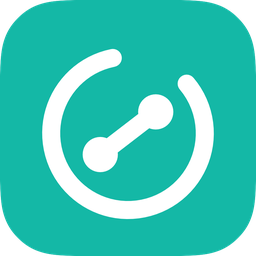
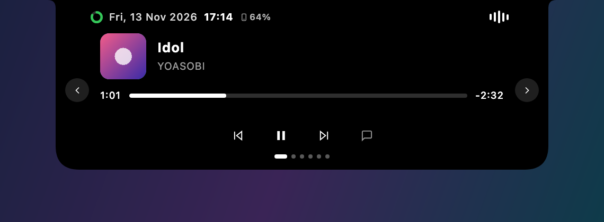

<p align="center">
  
</p>

<h1 align="center">DyskLink for Windows and Linux</h1>

<p align="center">Connects your PC and Android phone over local Wi-Fi or USB, with no cloud and no account.</p>

<p align="center">
  <a href="https://github.com/DyskLab/dysklink-desktop/releases/latest"></a>
  <a href="LICENSE"></a>
  <a href="https://dysklab.fanny.dev"></a>
  <a href="https://buymeacoffee.com/fannydevz"></a>
</p>



| Resting | Something running |
| --- | --- |
|  |  |

DyskLink puts the phone's clipboard, files, notifications, screen and camera on your PC, lets the phone control the
PC, and adds a set of optional tools, each off until you turn it on. It also connects to Macs running
[DyskLink for Mac](https://github.com/DyskLab/dysklink-mac).

**This is the Windows and Linux app. The phone app is [DyskLink for Android](https://github.com/DyskLab/dysklink-android).**
You need both to use the phone features. The app's source is in [`desktop/`](desktop); the protocol and connection
code it shares with the phone app is [`core/`](https://github.com/DyskLab/dysklink-android/tree/main/core) of the
Android repository, included here as the `android` submodule.

> DyskLink is still young, and this first release hasn't been tested on many PCs yet, so expect rough edges.
> Please report problems in [Issues](https://github.com/DyskLab/dysklink-desktop/issues).

## Download
Get the installer for your system from [Releases](https://github.com/DyskLab/dysklink-desktop/releases/latest). You need:

- Windows 10 or 11 (64-bit), or a 64-bit Linux desktop. On Linux, Wayland and X11 both work.
- [DyskLink for Android](https://github.com/DyskLab/dysklink-android/releases/latest) 1.5.0 or later on the phone
  (Android 8 or later).
- The phone and the PC on the same network, or connected by USB.

The installers include their own Java runtime, so nothing else needs to be installed first.

| System | Download | How |
| --- | --- | --- |
| Windows | `DyskLink-windows-x64.msi` or `DyskLink-windows-x64-setup.exe` | Run it. |
| Debian, Ubuntu | `DyskLink-linux-amd64.deb` | `sudo apt install ./DyskLink-linux-amd64.deb` |
| Fedora, openSUSE | `DyskLink-linux-x86_64.rpm` | `sudo dnf install ./DyskLink-linux-x86_64.rpm` (or `sudo zypper install`) |
| Other Linux | `DyskLink-linux-x64.tar.gz` | Unpack it and run `DyskLink/bin/DyskLink`. |

Then open DyskLink for Android on the same network, choose the PC, and type the 6-digit code the PC shows. After
that, they connect by themselves.

To update, install the new version over the old one. Pairings and settings are kept. DyskLink looks for a newer
version once a day, and its Download button opens the installer that suits your system. Nothing is installed by
itself.

## What it does

**The phone on your PC**
- Clipboard both ways, text and pictures.
- Send files both ways, with drag and drop, and a file history.
- Phone notifications and calls as PC notifications. One-time codes from SMS and notifications get a Copy button.
- Find your phone: ring it from the PC, even on silent, or ring the PC from the phone.
- USB mode: with USB debugging on, a plugged-in phone connects through the cable, without Wi-Fi.
- See and control the phone's screen with the mouse and keyboard, with its sound. Game keys map keyboard keys,
  joysticks, and mouse aim to spots on the screen, with a profile per game.
- The phone's camera in its own window, for OBS Window Capture, or as a webcam in Zoom, Meet, or Teams.
- Photos and videos, SMS conversations, contacts, and files on the phone.
- Play the phone's sound on the PC (Android 10 or later).

**The PC from your phone**
- Touchpad and keyboard, media remote, presentation remote, and Stream Deck.
- Commands and a terminal on the PC. Both are off until you turn them on for each phone.
- The PC's screen on the phone, with control.
- The phone as a second display of the PC.
- Hear the PC's sound on the phone.
- Barcodes, documents, and voice typing from the phone are typed or saved on the PC.
- The PC's Todo, Water, and Pomodoro, changed from the phone.

**With a Mac**
- Clipboard and files between this PC and a Mac running DyskLink for Mac 1.5.0 or later.
- One mouse and keyboard: the pointer can move between this PC and a Mac in both directions. Turn on "Use this PC's
  mouse and keyboard on a Mac" or "Let paired computers use their mouse and keyboard here" under Settings, Computers.

**Tools on the PC**
- Island: an optional notch-style island at the top of the screen with music and lyrics, clipboard, a file shelf,
  phone notifications and codes, prayer times, weather, Todo, Water, and Pomodoro.
- Clipboard history (Ctrl+Shift+V), with import from Ditto and CopyQ.
- Launcher (Alt+Space) for apps, files, DyskLink actions, sums, and emoji.
- Battery health, cycles, power, and history, with apps using significant energy (an estimate from CPU use).
- PC care: cleaner, duplicates, uninstall, and startup. Everything removed goes to the Recycle Bin or Trash.
- Window tidy: put windows in halves, thirds, or quarters, move them between monitors, and save layouts.
- Keyboard lock (Windows): turn off the PC's own keyboard for 1 minute to 1 hour, or until you unlock it. Unlock with the
  button in its small window, Ctrl+Alt+Shift+U, the timer, or Commands > Unlock the keyboard on a paired phone.
- A tray menu you can arrange, light and dark themes, start at login, and a daily check for new versions.

## Windows notes
- **SmartScreen:** the installer isn't signed by a known publisher, so Windows may warn about it. Choose
  **More info > Run anyway**.
- **Firewall:** allow DyskLink through Windows Firewall on private networks. If phones can't find the PC, DyskLink
  says so and points to Windows Security, Firewall & network protection.
- **Webcam:** using the phone as a webcam in other apps installs **DyskLink Camera**, a camera driver, once with
  administrator permission. Video apps then list DyskLink Camera.
- **Second display:** experimental. It needs a one-time install of the
  [Virtual Display Driver](https://github.com/VirtualDrivers/Virtual-Display-Driver) with administrator permission,
  which DyskLink offers when you turn it on.
- **USB:** some phones need their maker's USB driver. DyskLink finds `adb`, or downloads it from Google when you ask.

## Linux notes
DyskLink works on Wayland and X11. When something needs a package, a permission, or a desktop setting, DyskLink
shows what to install or allow, with the command to run, only when it applies.

- **Mouse and keyboard from the phone or a Mac:** on Wayland, the desktop asks for permission once (remote desktop
  portal). Sway and Hyprland use uinput instead, which needs a udev rule that DyskLink shows.
- **The PC's screen on the phone:** on Wayland, the desktop asks once which screen to share. It needs GStreamer with
  its PipeWire plugin.
- **Webcam:** the phone's camera as a system webcam needs the `v4l2loopback` kernel module (`v4l2loopback-dkms` on
  Debian, Ubuntu, and Arch, `v4l2loopback` from RPM Fusion on Fedora).
- **Tray icon:** works on KDE, Ubuntu, XFCE, and other desktops with StatusNotifierItem. Plain GNOME needs the
  [AppIndicator extension](https://extensions.gnome.org/extension/615/appindicator-support/).
- **Second display:** needs GNOME 40 or later, or KDE Plasma 6.1 or later, on Wayland. On X11 it only works with a
  spare VIRTUAL output.
- **Your PC's mouse and keyboard on a Mac:** needs X11 for now. The Mac's mouse and keyboard on this PC work on
  Wayland too.
- **Shortcuts on Wayland:** Ctrl+Shift+V and Alt+Space use the global shortcuts portal where the desktop has it.
  Otherwise, add a desktop shortcut that runs `dysklink --clipboard` or `dysklink --launcher`; DyskLink shows the
  exact command.
- **Window tidy:** X11 only, because Wayland doesn't let apps move other windows. On Wayland, DyskLink shows the
  tiling shortcuts of GNOME or KDE instead.
- **USB:** needs udev rules and the `plugdev` group, which DyskLink explains.
- **Firewall:** if firewalld or ufw is on, allow DyskLink's port and mDNS. DyskLink shows the command.

## Privacy
- Everything goes straight between your devices on the local network or over USB. There is no cloud, no account, and
  no DyskLink server.
- Devices pair with a 6-digit code shown on one and typed on the other, checked with a password-authenticated key
  exchange, and then talk over TLS.
- Phone data, the phone's screen, and control are off until you turn them on in the phone app. Commands and the
  terminal are off until you turn them on for each phone.
- DyskLink only reaches the internet to check GitHub for new versions, and for features you turn on: lyrics from
  LRCLIB (off by default), prayer times and weather for the city you choose, and downloading `adb` from Google.

## Build from source
You need JDK 17. The Android SDK isn't needed. Clone with the `android` submodule, which brings the shared `core/`:

```bash
git clone --recursive https://github.com/DyskLab/dysklink-desktop.git
cd dysklink-desktop
```

In a clone made without `--recursive`, run `git submodule update --init` first.

```bash
./gradlew :desktop:run                    # on a Mac, also set DYSKLINK_PORT=47831 next to DyskLink for Mac
./gradlew :desktop:createDistributable    # desktop/build/compose/binaries/main/app/DyskLink
./gradlew :desktop:packageMsi             # on Windows; packageExe for the setup .exe
./gradlew :desktop:packageDeb             # on Linux; packageRpm for the .rpm
./gradlew :core:test :desktop:test
```

`DYSKLINK_SNAPSHOTS=<folder> ./gradlew :desktop:test --tests '*SnapshotTest*'` renders PNGs of the screens and the
island.

Each installer can only be made on its own system, so GitHub Actions (`.github/workflows/desktop.yml`) runs the tests
and then builds them on Windows and Ubuntu runners: `DyskLink-windows-x64.msi`, `DyskLink-windows-x64-setup.exe`,
`DyskLink-linux-amd64.deb`, `DyskLink-linux-x86_64.rpm`, and `DyskLink-linux-x64.tar.gz`. The Windows build also
bundles the DyskLink Camera webcam filter (built from [softcam](https://github.com/tshino/softcam)) and the
[Virtual Display Driver](https://github.com/VirtualDrivers/Virtual-Display-Driver) used for the second display. A
local build has neither driver. The installers are uploaded as workflow artifacts and published by hand as releases
here.

Discovery uses jmDNS with a host name of its own, so it works next to the Bonjour that Windows, macOS, and Avahi run.

To build against a `core/` you are changing in a dysklink-android checkout, set `DYSKLINK_ANDROID_DIR` to that
checkout. To take a newer `core/` for good, move the submodule forward and commit it:

```bash
git submodule update --remote android
git add android
```

The tests that need a running Mac app are skipped here. `scripts/pc-sync-test.sh` in
[dysklink-mac](https://github.com/DyskLab/dysklink-mac#tests) runs the computer side against the Mac app. All apps
speak the protocol in [docs/PROTOCOL.md](https://github.com/DyskLab/dysklink-mac/blob/main/docs/PROTOCOL.md).

## Support
DyskLink is free and open source under the [MIT License](LICENSE). If it helps you, you can
[buy me a coffee](https://buymeacoffee.com/fannydevz).

## Part of DyskLab
DyskLink is part of [DyskLab](https://dysklab.fanny.dev), alongside
[DyskFlow](https://github.com/DyskLab/dyskflow), [DyskFiles](https://github.com/DyskLab/dyskfiles), and
[DyskFocus](https://github.com/DyskLab/dyskfocus).
